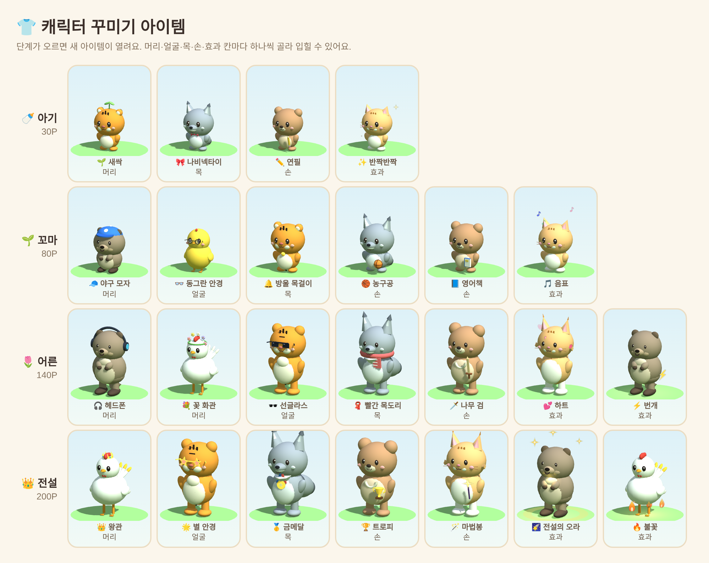

# 🏝️ 영어 학습 섬 (English Island)

학습일지를 3D 섬 게임으로 만든 웹앱이에요. 학생은 섬에서 동물 친구(호랑이·늑대·병아리(→닭)·곰·고양이·쿼카)를 키우며 일지를 쓰고,
우체통·게시판·책장(단어장)·오락기·책상·달력·보물상자를 눌러 각 기능을 써요. 같은 기능을 오른쪽 글자 메뉴로도 열 수 있어요.

**조작**: 방향키(또는 WASD)로 친구 움직이기 · Shift 누르면 달리기 · 사물 앞에서 Space/Enter로 열기 · 마우스 드래그로 섬 돌리기 · 휠로 확대

> 다음 학년도용으로 준비 중인 앱이에요. 지금 쓰는 학습일지(Apps Script)와는 별개로 돌아가요.

## 🐾 친구 진화 도감

포인트가 쌓이면 5단계로 자라요: 🥚 알 (0P) → 🍼 아기 (30P) → 🌱 꼬마 (80P) → 🌷 어른 (140P) → 👑 전설 (200P)

## 👕 캐릭터 꾸미기

메뉴의 **캐릭터 꾸미기**(또는 내 친구 → 꾸미기)에서 머리·얼굴·목·손·효과 칸마다 아이템을 하나씩 골라 입혀요. 단계가 오를 때마다 새 아이템이 열려요.

| 단계 | 열리는 아이템 |
|---|---|
| 🍼 아기 (30P) | 🌱 새싹, 🎀 나비넥타이, ✏️ 연필, ✨ 반짝반짝 |
| 🌱 꼬마 (80P) | 🧢 야구 모자, 👓 동그란 안경, 🔔 방울 목걸이, 🏀 농구공, 📘 영어책, 🎵 음표 |
| 🌷 어른 (140P) | 🎧 헤드폰, 💐 꽃 화관, 🕶️ 선글라스, 🧣 빨간 목도리, 🗡️ 나무 검, 💕 하트, ⚡ 번개 |
| 👑 전설 (200P) | 👑 왕관, 🌟 별 안경, 🥇 금메달, 🏆 트로피, 🪄 마법봉, 🌠 전설의 오라, 🔥 불꽃 |

꾸민 모습은 실제 운영(API 연결) 때 시트 `Islands`에 저장돼서(자동으로 만들어져요) 다른 기기에서도 그대로 보여요. 체험 모드에서는 그 브라우저에 저장돼요.

## 📚 단어장

섬의 책장을 누르면 **My vocabulary**가 열려요. 단어를 저장할 때마다 책장에 책이 한 권씩 꽂혀요(최대 21권).

## ⚔️ 반 대항 보스전

매주 월요일 섬 옆 하늘에 새 보스(먹구름 대왕 · 게으름 슬라임 · 망각 골렘)가 나타나요. 반 학생들이 함께 체력을 깎아요.

| 공격 | 데미지 |
|---|---|
| ⚔️ 보스 단어 대결 (보스를 클릭, 30초, 하루 1번) | 정답마다 -2, 3연속부터 콤보 +1, 최대 -20 |
| 📖 일지 쓰기 (하루 1번까지) | -10 |
| 🎮 단어 게임 만점 | -5 |
| 💰 선생님 칭찬 보너스 | -5 |

- 보스 체력 = 반 인원 × 30 (최소 100), 일요일 밤에 끝나요.
- 보스를 클릭하면 단어 대결이 열려요. 내 단어장 → 우리 반 단어장 → 기본 단어(80개) 순서로 문제가 나와요.
- 일지를 쓰면 친구가 보스를 공격하는 연출이 나와요. 쓰러뜨리면 보스는 사라지고(집 지붕에 승리 깃발) 다음 월요일에 새 보스가 나타나요.
- 학생 화면: 보스 체력 바, 우리 반 공격왕, 반 대항 순위
- 교사 화면(학급 → 학생 목록 위): 이번 주 현황, 격파하면 **반 전체 +3P 보상 주기** 버튼

## 파일

| 파일 | 역할 |
|---|---|
| `index.html` | 앱 전체 (Vercel이 이 파일을 그대로 보여줘요) |
| `apps-script/api.gs` | 내년용 Apps Script에 추가하는 데이터 API |

## 세 가지 실행 방식 (같은 index.html 하나로)

`index.html` 안의 `APP_CONFIG`가 정해요.

1. **체험 모드** — `API_URL`이 비어 있을 때. 가짜 데이터로 모든 기능을 둘러봐요. 데이터는 그 브라우저에만 저장돼요.
   - 학생: 1학년 1반 1번 김하늘 / 1234 (다 자란 친구) · 새 학생으로 들어가면 알부터 시작
   - 같은 반 체험용 친구 3명(이준호·최민재·정우진)이 보스전에 함께 참여해요
   - 교사 비밀번호: `000000`
2. **실제 운영 (Vercel + Apps Script)** — `API_URL`에 내년용 Apps Script 웹 앱 주소를 넣으면, 구글 시트에 저장돼요.
3. **Apps Script 안에서** — 이 파일을 Apps Script 프로젝트의 HTML로 붙여 넣으면 지금처럼 `google.script.run`으로 돌아가요.

## 내년에 실제로 쓸 때

1. 지금 쓰는 Apps Script 프로젝트와 시트를 **사본으로 복사** (올해 것은 그대로 둬요)
2. 복사한 프로젝트에 `apps-script/api.gs` 추가 → **웹 앱으로 배포** (실행: 나 / 액세스: 모든 사용자)
3. `index.html`의 `APP_CONFIG.API_URL`에 웹 앱 주소(`/exec`) 입력, `SUBTITLE`을 새 학년도에 맞게 수정
4. GitHub에 올리면 Vercel이 자동으로 다시 배포해요

## Vercel 연결 (처음 한 번)

vercel.com → **Add New → Project** → `english-island` **Import** → **Deploy**
(빌드 설정 없이 그대로 배포돼요. 이후 GitHub에 올릴 때마다 자동 배포)

## 참고

- 3D는 Three.js(jsDelivr CDN)를 써요. 불러오지 못하면 3D 대신 일반 배경이 나오고, 글자 메뉴로 모든 기능을 그대로 쓸 수 있어요.
- 자동 로그인은 각 기기 브라우저에 저장돼요.
